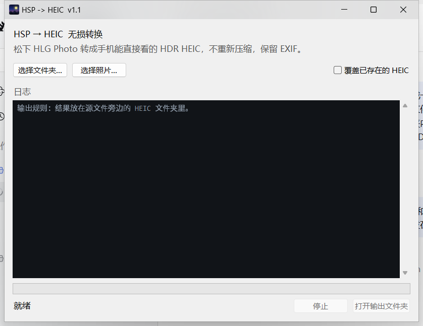

# 松下 HLG Photo (.HSP) → HEIC

**把松下 LUMIX 的 HLG Photo 无损转换成手机能直接看的 HDR HEIC。**

[English](README.en.md) · [MIT 协议](LICENSE) · [样片：CC BY-NC-SA 4.0](samples/README.md)




---

## 网页版（新增）

**<https://hlgconv.biotech-prank-0u.workers.dev>**

不想装软件，或者人在 iPad / 手机上时，打开这个页面就行：

- 拖入或选择 `.HSP`，单张多张都可以（只接受 `.HSP`，其他格式会被挡掉并提示）
- 单张 → 直接下载 `.HEIC`；多张 → 打包成一个 `.zip`
- 转换在**你的浏览器里**完成，照片不会上传到任何服务器，也没有云端副本需要删除
- 有总进度条、逐张状态、夜间模式，手机 / iPad 自适应
- 输出与下面的命令行工具**逐字节相同**（三个样片的 SHA-256 一致）

源码在 [`web/`](web/)，Astro + 原生 JS；转换内核 [`web/src/lib/hsp2heic.js`](web/src/lib/hsp2heic.js)
是 `hsp2heic.py` 的移植版，跑在浏览器里，不需要服务器算力。

> 提示：`*.workers.dev` 在中国大陆直连不稳定，可能需要代理。纯本地转换也可以直接用下面的 Windows 版本。

---

## 为什么需要它

松下的 **HLG Photo** 格式（`.HSP`，S1 / S5 / S5 II 等机型支持）保存的是 10-bit HLG HDR
静态照片，但只有松下的 Windows 查看扩展和 Photoshop 插件能打开。手机打不开，HDR 就被
困在电脑里。

**HEIC 本质就是 HEVC 编码的 HEIF 容器**，而 `.HSP` 里面已经是一段 HEVC Main10 码流。
所以完全不需要解码再重新压缩：只要把码流重新装进 HEIC 容器、写对色彩标签，iPhone、
iPad、Android 上的相册就能直接打开，HDR 也能保留。

## 下载

| 版本 | 文件 | 适合 |
|---|---|---|
| **网页版（新增）** | [hlgconv.biotech-prank-0u.workers.dev](https://hlgconv.biotech-prank-0u.workers.dev) | iPad / 手机 / 别人的电脑，打开即用，照片不上传 |
| **Windows 图形界面（推荐）** | [HSP2HEIC.exe](https://github.com/Baizhi-Angelica/panasonic-hsp-to-heic/releases/latest/download/HSP2HEIC.exe) | 双击运行，选择文件夹或照片即可 |
| **Windows 便携版** | [HSP2HEIC-portable-win64.zip](https://github.com/Baizhi-Angelica/panasonic-hsp-to-heic/releases/latest/download/HSP2HEIC-portable-win64.zip) | 解压即用，内置 Python，命令行 / bat |
| 源码 | `python hsp2heic.py` | 已装 Python 3.8+，无第三方依赖 |

全部版本都在 [Releases](https://github.com/Baizhi-Angelica/panasonic-hsp-to-heic/releases) 页面。

## 一、图形界面（exe）

1. 双击 **`HSP2HEIC.exe`**。
2. 点 **选择文件夹**（递归转换里面所有 `.HSP`）或 **选择照片**（可多选）。
3. 转换完成后，结果在源文件旁边的 **`HEIC`** 子文件夹里；原 `.HSP` 不动。
4. 点 **打开输出文件夹** 直接查看。

选项：勾选“覆盖已存在的 HEIC”会重新生成同名文件；转换过程中可以点“停止”。

> **Windows 提示“未知发布者”？** exe 没有购买代码签名证书，SmartScreen 会拦一下。
> 点“更多信息 → 仍要运行”即可。
>
> **杀毒软件误报？** PyInstaller 打包的程序偶尔会被误报。可以换成便携版（纯 Python + bat），
> 或把 exe 加入白名单。

## 二、便携版（zip）

解压后目录：

```
HSP2HEIC-portable\
├─ convert.bat          ← 双击这个
├─ hsp2heic.py
├─ 使用说明.txt
├─ raw_file\            ← 把 .HSP 放这里
└─ _tool\python\        ← 内置 Python，无需安装
```

1. 把 `.HSP` 放进 `raw_file\`（或任意文件夹）。
2. 双击 `convert.bat`。
3. 结果在 `raw_file\HEIC\`。

也可以把任意文件夹或几个 `.HSP` 文件**拖到 `convert.bat` 上**，程序会递归处理，
并在每个源文件夹旁边生成 `HEIC\`。

## 三、命令行 / 源码

需要 Python 3.8+（只用标准库，不用 `pip install` 任何东西）：

```bash
python hsp2heic.py                        # 转换 ./raw_file
python hsp2heic.py "D:\照片\码头"          # 转换指定文件夹
python hsp2heic.py a.HSP b.HSP            # 转换单个文件
```

| 参数 | 说明 |
|---|---|
| `--out DIR` | 全部输出到 `DIR`，不建 `HEIC\` 子文件夹 |
| `--force` | 覆盖已存在的 `.HEIC` |
| `--replace` | 转换成功后删除原 `.HSP`（谨慎） |
| `--no-recursive` | 不递归子文件夹 |
| `--lang zh\|en` | 指定输出语言（默认跟随系统） |
| `-h`, `--help` | 显示帮助 |

## 四、网页版（浏览器本地转换）

**<https://hlgconv.biotech-prank-0u.workers.dev>**

整个转换在浏览器里完成，照片没有任何上传动作——页面里根本不存在上传接口。

- 拖入或选择 `.HSP`，单张多张都行（只接受 `.HSP`，其他格式会被忽略并提示）
- 单张 → 直接下载 `.HEIC`；多张 → 打包成一个 `.zip` 下载
- 有总进度条、逐张状态、暗色模式，手机 / iPad 自适应
- 输出与命令行工具**逐字节相同**（样片 SHA-256 一致）

源码在 [`web/`](web/)，Astro + 原生 JS，转换内核是 `web/src/lib/hsp2heic.js`（`hsp2heic.py` 的移植版）：

```bash
cd web
npm install
npm run dev        # 本地开发
npm run verify     # 用 samples/ 校验输出与参考 HEIC 字节一致
npm run build
```

## 特性

- **真正无损** —— HEVC 码流逐字节拷贝，不解码、不二次压缩。
- **保留 HDR** —— 10-bit 4:2:0、BT.2020 原色、HLG 传输、BT.2020 非恒定亮度矩阵、limited range。
- **保留 EXIF** —— 机身、镜头、拍摄时间（含时区）、快门、光圈、ISO、焦距、作者、版权。
- **快** —— 2400 万像素约 10 毫秒一张。
- **零依赖** —— 纯 Python 标准库；Windows 版已打包好 Python。
- **中英双语** —— 界面和命令行自动跟随系统语言。

## 原理

```
.HSP（TIFF 容器）
├── IFD0 + ExifIFD  ──────────────► 重建成标准 EXIF
├── 64 KB 松下私有块（尺寸、统计信息，本工具不使用）
├── HEVC Main10 Annex B 码流 ─────► 逐个 NAL 搬进 HEIF 的 mdat
└── JPEG 预览图（IFD1/IFD2）       不使用

.HEIC（ISO/IEC 23008-12）
├── ftyp   heix / mif1 / miaf
├── meta   hvcC（从码流提取的 VPS/SPS/PPS）、colr nclx、ispe、pixi
├── mdat   原始图像分片
└── Exif   通过 cdsc 引用关联到主图
```

除了容器头、色彩描述和 EXIF 之外，工具不写任何像素数据。格式细节见
[docs/hsp-format.md](docs/hsp-format.md)。

## 输出文件

| 项目 | 内容 |
|---|---|
| 容器 | HEIC（`heix`，兼容 `mif1` + `miaf`） |
| 图像 | 5984 × 4000，10-bit，4:2:0（与相机码流一致） |
| 色彩 | BT.2020 / HLG / BT.2020 NC，limited range（`nclx` 9/18/9，full_range = 0） |
| 元数据 | 标准 EXIF（不含 MakerNote，见限制） |
| 体积 | 约为原 `.HSP` 减去内嵌 JPEG 预览图，2400 万像素约 2.6–4.5 MB |
| 速度 | 每张约 10 毫秒 |

## 兼容性

| 平台 | 表现 |
|---|---|
| iPhone / iPad（相册） | 原生打开；支持 HDR 的屏幕按 HDR 显示 |
| Windows 11（照片 / 资源管理器） | 需要 Microsoft Store 免费的“HEIF 图像扩展” |
| Android / Google Photos | 支持 HEIF 的相册都能打开，HDR 取决于设备 |
| 只支持 SDR 的查看器 | 由系统自动 tone mapping，不会发灰或全黑 |
| 微信等聊天软件 | 发送时可能被转成 SDR JPEG，原文件不受影响 |

## 限制

- 只支持 **4:2:0、10/12-bit 的 HLG** HEVC 码流，也就是 LUMIX HLG Photo 实际写出的格式。
- 松下的 **MakerNote** 不保留：它使用绝对文件偏移，换容器后无法安全搬迁。
- **GPS** 不保留（参考样片里本来也没有）。
- EXIF 的 `Orientation` 原样保留，但不写 HEIF 的 `irot` 盒；参考样片都是 orientation 1。
- 输出是标准的 **HLG HEIC**，不是 Apple / ISO 21496-1 的“增益图”HDR 照片。
  iOS 18 与 Android 15 的增益图 HDR 可以在后续版本里加。
- Windows 资源管理器的属性面板对 HEIC 只显示部分 EXIF；元数据本身在文件里
  （可用 exiftool、Lightroom 或 iPad 查看）。

## 验证情况

- 13 张样片，机身 **DC-S5（固件 2.8）**，镜头 APO-SUMMICRON-SL 35 mm f/2。
- 每张输出的 HEVC 分片与源 `.HSP` **逐字节相同**。
- 全部输出经 **libheif 1.23.6** 与 **Windows Imaging Component (WIC)** 解码验证。
- 色彩标签确认：`nclx: primaries=9, transfer=18, matrix=9, full_range=0`。
- exe 与便携版都用样片跑过自检，输出哈希与参考文件一致。

## 样片

[`samples/`](samples/README.md) 里有三组参考文件：

| 文件 | 场景 | 选它的原因 |
|---|---|---|
| `_PAN0301` | 黄昏码头 | 亮天空 + 深阴影 |
| `_PAN0766` | 室内逆光窗 | 极大动态范围 |
| `_PAN0976` | 湖光山色 | 平滑渐变，检查色彩过渡 |

照片采用 **CC BY-NC-SA 4.0** 协议，与代码的 MIT 协议分开。

## 协议

- **代码** —— [MIT](LICENSE)，© 2026 Baizhi-Angelica。
- **样片** —— [CC BY-NC-SA 4.0](samples/LICENSE-CC-BY-NC-SA-4.0.txt)，© 2026 Baizhi-Angelica。

HEIC/HEVC 的专利授权与本仓库无关；本工具只重新封装你自己已经拥有的数据。

## 致谢

- [libheif](https://github.com/strukturag/libheif) 及其解码栈，用于验证输出。
- 以及此前所有记录过 HLG Photo 格式的人。
